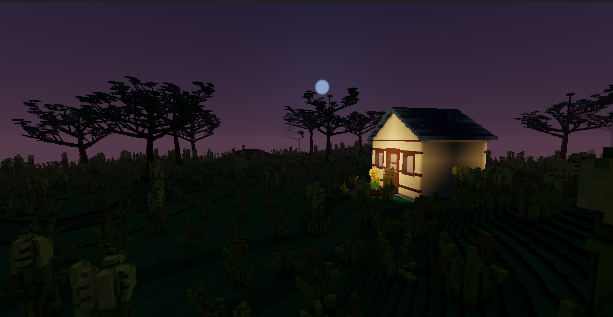
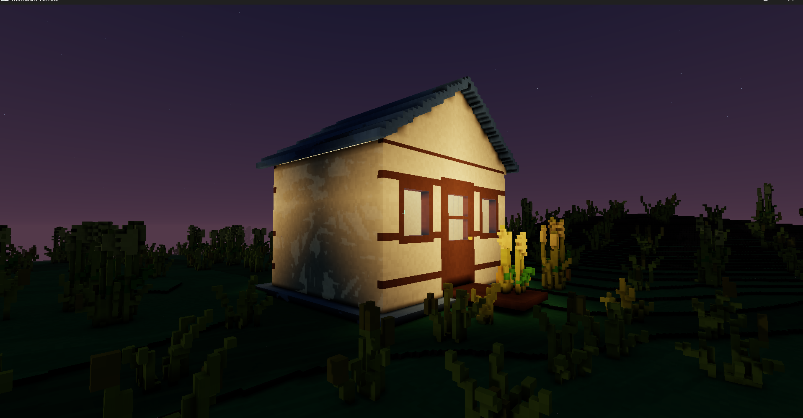
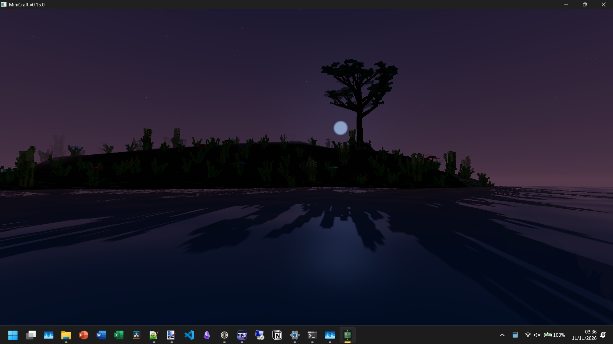

# MiniCraft

A native Rust voxel world explorer with 6.25 cm voxels. Each cubic metre contains a 16 × 16 × 16 grid of individually editable voxels.

Explore an infinite world with branching trees, seeded grass, flowers, underwater plants, caves and occasional cottages. Warm lamplight passes through glass, doors swing on their hinges, and a day/night cycle changes the view as you travel. Terrain generation comes from [Paper-Minecraft](https://github.com/CowgillAlex/Paper-Minecraft), sampled at its original metre scale with sixteen times the resolution along each axis.



Screenshots from Alex's world, seed `8349847389`.

| Cottage lamplight | Moonlit shore |
| --- | --- |
|  |  |

## Windows download

Download the latest Windows x64 executable or ZIP from [GitHub Releases](https://github.com/CowgillAlex/minicraft/releases/latest). The [changelog](CHANGELOG.md) records every archived version back to the first Cedar Voxel Lab build.

## Build and run

Install [Rust](https://rustup.rs/) and a GPU driver with Vulkan, DirectX 12 or OpenGL support, then run from the repository root:

```sh
cargo run --release --locked
```

Linux system packages and Windows packaging instructions are in the [development guide](docs/development.md). Assets are embedded in the executable.

Choose a seed on the title screen or leave it blank for a random world. Terrain, meshes and lighting stream as you explore. The world spans -64 to 320 metres vertically, with configurable render distance, fog and adaptive detail. Edits stay in memory while you explore, but nothing is saved to disk yet.

## Controls

| Key | Action |
| --- | --- |
| WASD / mouse | Move / look |
| Space | Jump, or fly up |
| Ctrl / Shift | Sprint / slow down; Shift flies down in flight |
| F / F5 | Toggle flight / spectator mode |
| Left / right click | Break / place a voxel |
| Middle click or # | Pick the targeted material |
| 1–0 / Tab | Select a hotbar material / open all materials |
| E | Open or close a door |
| - / = | Move time backward / forward |
| F6 | Toggle night vision |
| F1 / F3 / H | Controls / debug info / hide HUD |
| Esc | World menu and settings |

Settings include ambient occlusion, VSync, distance, fog and an option to follow your local clock. F3 shows the biome and targeted block. The [development guide](docs/development.md) lists all controls and command-line options.

## Development

The game is a single Rust crate. `src/` contains the game and renderer, `assets/` contains embedded resources and worldgen data, and `scripts/` contains packaging, reference-data and screenshot tools.

```sh
cargo test --release --locked
```

See the [development guide](docs/development.md) for renderer details, generation, lighting, tests and versioned Windows builds. The [worldgen source notes](assets/worldgen/README.md) describe the Paper-Minecraft port and MiniCraft's adaptations.
